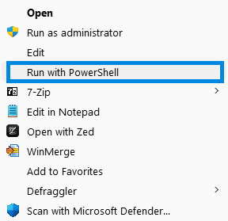

# 📊 MediaDashboard_v0.03beta

### ⚡ TL;DR
* **Zero-byte edits:** Only updates file system timestamps—your original bytes and metadata stay 100% untouched[cite: 1, 3].
* **Built for messy archives:** Camera rolls, old phones, dashcams, screenshots, and "historical" folders[cite: 1, 3].
* **Portable & lightweight:** Runs via PowerShell with no heavy setup[cite: 1, 3].
* **Made by MidnightTabby:** Fueled by late nights, regexes, and a desire to keep your timeline in order[cite: 1].

---

## 🚀 Why This Exists

If your camera roll, external SSD, or project folder is an absolute graveyard of mystery `.mp4` and `.mov` clips, you know the struggle:
- You have **gigabytes of footage you'll never actually use**, buried because you don't have time to watch every single clip.
- Some clips are secretly **Dolby Vision / HDR10** (ready to blow out your timeline colors).
- Mobile recordings are constantly whispering at **-30 dB (`LOW_VOL`)**, forcing you to guess gain settings in post.
- You just want to **re-encode or match export specs** without decoding cryptic `ffprobe` walls of text.

**MediaDashboard** scans your archive in seconds and outputs a clean, **unquoted UTF-8 TSV** file ready for Excel, Google Sheets, or CLI filtering—helping you spot trash clips to delete and prep the keepers for editing.
**"Stop guessing why that 4K clip feels heavy—audit your entire media stash in one clean TSV."**  
A fast PowerShell media triage & quality dashboard powered by `ffprobe` (and optional `ffmpeg` audio loudness checks) to help creators declutter raw footage, spot HDR/VFR quirks, and prep exports without opening 40 tabs.

Companion to [**MediaTimestampFixer**](https://github.com/MidnightTabby/MediaTimestampFixer). Keep your timestamps straight with one, and inspect your footage specs and audio levels with the other.
---

## ✨ Key Features

- **⚡ Blazing-Fast Metadata Scan (`ffprobe`)**: Extracts resolution, FPS, codecs, video/audio bitrates, color space, and camera models across entire directory trees without touching your original files (**100% non-destructive**).
- **🧹 Spot Unused & Low-Value Footage Instantly**: Sort by `Size_MB`, `Duration`, or `YT_Ready_Mode` (`8K`, `4K`, `1080p`, `HD`, `HD_CROPPED`, `SD`) to catch accidental pocket recordings, low-res scraps, and storage hogs before editing.
- **🌈 HDR & Color Space Decoder**: Translates cryptic transfer characteristics into plain labels (`DolbyVision`, `HDR10`, `HLG`, `HDR_OTHER`, `SDR`) alongside raw `Color_Space` values.
- **🎛️ Re-Encode Reference Layout**: Columns are ordered logically (`File Info` → `Video Specs` → `Audio Specs` → `YT Flags`) so you have exact bitrates, sample rates, and codecs right next to each other.
- **🔊 Optional Audio Diagnostics (`-AudioCheck`)**: Runs `ffmpeg` `volumedetect` to flag quiet mobile footage (`LOW_VOL`) or clipped audio (`CLIP`) with measured mean/peak dB levels.
- **📄 Clean, Unquoted TSV Output**: Exported with UTF-8 BOM and zero annoying double-quotes (`""`) for effortless spreadsheet pasting and text parsing.

---

## 📋 Dashboard Columns Explained

| Group | Columns | What It Tells You |
| :--- | :--- | :--- |
| **File & Device** | `FullName`, `Size_MB`, `Duration`, `Camera_model`, `Container` | Where it lives, how heavy/long it is, and what shot it (e.g., iPhone model tags). |
| **Video Specs** | `Resolution`, `FPS`, `V_Codec`, `V_Bitrate_kbps`, `Color_Space`, `HDR_Mode` | Exact specs for matching re-encodes + instant HDR warning labels. |
| **Audio Specs** | `A_Codec`, `A_Bitrate_kbps`, `A_SampleRate` | Clean audio specs without redundant VBR/CBR guesswork. |
| **YT Readiness** | `YT_Ready_Mode`, `YT_Progressive`, `YT_CFR`, `YT_Audio_48k` | Quick sanity checks for frame-rate stability (CFR), progressive scan, and 48kHz audio. |
| **Audio Check*** | `Measured_dB`, `Peak_dB`, `Audio_Flag` | *(Appended when `-AudioCheck` is enabled)* Flags `LOW_VOL` or `CLIP`. |

---

## ⚡ Quick Start & Usage

### 1. Prerequisites
- **Windows 10 / 11** (PowerShell 7 recommended / Windows PowerShell 5.1+)
- **`ffprobe.exe` (Required)** & **`ffmpeg.exe` (Required only with `-AudioCheck`)**:  
  Official FFmpeg builds for Windows x64 are distributed via trusted community builds:
  - **Gyan.dev** ([Windows builds](https://www.gyan.dev/ffmpeg/builds/#release-builds)): Download **`ffmpeg-release-essentials.zip`** (lighter and plenty for `MediaDashboard`—includes `ffmpeg.exe`, `ffprobe.exe`, and `ffplay.exe` in folder named `bin`).
  - **BtbN** ([FFmpeg-Builds Releases](https://github.com/BtbN/FFmpeg-Builds/releases)): Download the latest **`win64-gpl`** `.zip` archive if you prefer GitHub releases.
  - Extract `bin\ffprobe.exe` (and `bin\ffmpeg.exe` if you plan to use `-AudioCheck`) into a folder included in your **System PATH**, or place them alongside the script.

### 2. Folder Structure
Keep your workspace tidy—put the script in your project/toolkit folder (and `ffprobe.exe` / `ffmpeg.exe` either on your `PATH` or right next to it):

```text
📁 MediaDashboard/
 ├── 📜 MediaDashboard_v0.03beta.ps1
 ├── ⚙️ ffprobe.exe          # Optional if already in System PATH
 └── ⚙️ ffmpeg.exe           # Optional (only needed with -AudioCheck)
 ```

### 3. Run the Scanner
Open PowerShell in your folder and run:

#### Fast scan (everyday triage—resolution, HDR, FPS, YouTube flags)[cite: 2]:
```powershell
.\MediaDashboard_v0.03beta.ps1 -TargetPath "D:\Videos\Chaos_Archive" -OutputTsv ".\media_dashboard.tsv"
```

#### Audio check mode (adds Measured_dB, Peak_dB, and Audio_Flag)[cite: 1, 2]:
```powershell
.\MediaDashboard_v0.03beta.ps1 -TargetPath "D:\Videos\Chaos_Archive" -OutputTsv ".\media_dashboard.tsv" -AudioCheck
```

#### Optional Parameters
- `-LowVolThresholdDb` (Default: `-24.0`): Adjust sensitivity for `LOW_VOL` flags.
- `-ClipPeakThresholdDb` (Default: `-0.1`): Adjust peak threshold for `CLIP` warnings.

### 4. Open the generated .tsv in Excel, Google Sheets, or your favorite viewer to filter, sort, and make quick storage/edit calls.

---

## 🗺️ Roadmap (Coming Soon)
- **Suggested Gain Hints**: Pair `LOW_VOL` with estimated boost hints (e.g., `+12dB` headroom guide) while keeping `Peak_dB` in check.
- **Flexible Date Formatting**: Keep ISO default sorting while offering optional US-friendly date formats (`MM/dd/yyyy`, casual `WED Sept 21 6p` style notes).
- **Cross-Platform / Lightweight Helper**: Exploring standalone Go helpers for zero-dependency portability across Windows, macOS, and Chromebook (Linux).

---

## ☕ Credits & Behind the Scenes
- **FFmpeg / ffprobe Team**: For powering practically every media pipeline on planet Earth.
- **Author**: **MidnightTabby** — fueled by late-night coffee and an urge to bring *Aesthetic peacekeeping* to messy hard drives.
- **AI Collaborator**: **Gemini** — helping translate late-night workflow ideas and real-world creator headaches into clean PowerShell.

---

## 💡 Pro Tips & Shortcuts

- **CLI / `winget` shortcut**: Prefer installing via terminal? Run `winget install --id=Gyan.FFmpeg -e` in PowerShell, then restart your terminal so `PATH` updates pick up `ffprobe.exe` and `ffmpeg.exe`.

- **`essentials` vs. `full`**: `MediaDashboard` only needs `ffprobe` and `ffmpeg` (volumedetect), so `release essentials` saves bandwidth and disk space without sacrificing functionality.

- **Test small first**: Point `-TargetPath` at a single folder of mixed clips before scanning a massive multi-terabyte archive.

---

# 💡 Quick Tips: Fast Pre-Scan Recon (`ls` Style, No Heavy Tools Needed)

Before running deep media scans, heavy metadata/audio checks, or full hash comparisons across massive folders, use these three lightweight PowerShell snippets. They evolve the classic DOS/PowerShell `>` pipe/redirect workflow into clean, tab-separated (`TSV`) files with timestamps—zero extra installs, zero edits to your original files.

<p align="right">
  
</p>

> **📌 How to Run Any Snippet Below (No Terminal Needed)**
> 1. **Copy** the PowerShell code block below.
> 2. Save it in your target folder as a `.ps1` file (e.g., `scan_files.ps1`) encoded in **UTF-8**.
> 3. In Windows File Explorer, **right-click** the `.ps1` file and select **Run with PowerShell** (see image above).
> 4. Check the generated `*.tsv` report right next to your script—your original files are never modified.

## 1. Fast Recursive File & Size Inventory (`filelist_*.tsv`)

Want a quick list of **every file, size in MB, and last modified date** across a folder (including subfolders)? Press **Enter** to scan your current folder—or paste any folder path you want to check:

```powershell
# Prompt for target folder (press Enter to use the current folder)
$TargetDir = Read-Host "Target folder path (Press Enter for current folder)"
if ([string]::IsNullOrWhiteSpace($TargetDir)) {
    $TargetDir = (Get-Location).Path
}
$TargetDir = $TargetDir.Trim('"', "'", ' ')

# Save a timestamped TSV inside the scanned folder
$Stamp = Get-Date -Format "yyyyMMdd_HHmmss"
$OutFile = Join-Path $TargetDir "filelist_$Stamp.tsv"
$StartTime = Get-Date

Get-ChildItem -Path $TargetDir -Recurse -File -ErrorAction SilentlyContinue |
    Select-Object FullName,
        @{Name = "Size_MB"; Expression = { [math]::Round($_.Length / 1MB, 2) }},
        LastWriteTime |
    Export-Csv -Path $OutFile -Delimiter "`t" -Encoding UTF8

$Elapsed = (Get-Date) - $StartTime
Add-Content -Path $OutFile -Value "`nElapsed: $($Elapsed.ToString('hh\:mm\:ss'))" -Encoding UTF8

Write-Host "Saved to: $OutFile"
```

- **Zero path editing needed:** Works right out of the box on any drive, USB/SSD, or folder.
- **Tab-separated (`TSV`):** Commas in filenames won't break your columns, and each run creates a timestamped file so you don't accidentally overwrite earlier snapshots.
- **Elapsed time at the bottom:** Appends total scan duration so you know how long big folders take.

## 2. Extension & Size Breakdown (`ext_summary_*.tsv`)

Want to see what file types are actually eating up your drive or folder before deciding what to keep, convert, or clean up? Run this in your target folder:

```powershell
$TargetDir = (Get-Location).Path
$Stamp     = Get-Date -Format "yyyyMMdd_HHmmss"
$OutFile   = Join-Path $TargetDir "ext_summary_$Stamp.tsv"

Get-ChildItem -LiteralPath $TargetDir -Recurse -File -ErrorAction SilentlyContinue |
    Group-Object Extension |
    Select-Object @{Name = "Extension"; Expression = { if ($_.Name) { $_.Name.ToLower() } else { "(no_ext)" } }},
        @{Name = "Count"; Expression = { $_.Count }},
        @{Name = "Total_MB"; Expression = { [math]::Round((($_.Group | Measure-Object Length -Sum).Sum / 1MB), 2) }} |
    Sort-Object Total_MB -Descending |
    Export-Csv -Path $OutFile -Delimiter "`t" -Encoding UTF8

Write-Host "Saved -> $OutFile"
```

- **Fast terrain check:** Shows file counts and total MB per extension so heavy formats jump right out.
- **Spreadsheet-friendly:** Tab-separated (`TSV`) output stays clean when sorting or filtering.

## 3. Quick Duplicate Candidates (`dup_candidates_*.tsv`)

Before burning time calculating hashes across huge archives, spot obvious same-name + same-byte-size clones across folders in seconds:

```powershell
$TargetDir = (Get-Location).Path
$Stamp     = Get-Date -Format "yyyyMMdd_HHmmss"
$OutFile   = Join-Path $TargetDir "dup_candidates_$Stamp.tsv"

Get-ChildItem -LiteralPath $TargetDir -Recurse -File -ErrorAction SilentlyContinue |
    Group-Object Length, Name |
    Where-Object { $_.Count -gt 1 } |
    ForEach-Object {
        $_.Group | Select-Object @{Name = "GroupCount"; Expression = { $_.Count }},
            @{Name = "Size_MB"; Expression = { [math]::Round($_.Length / 1MB, 2) }},
            Name, FullName, LastWriteTime
    } |
    Export-Csv -Path $OutFile -Delimiter "`t" -Encoding UTF8

Write-Host "Saved -> $OutFile"
```

- **Fast triage, not final verdict:** Matches identical file **size + name** for quick leads—renamed copies or coincidental same-name/same-size files can still appear, so double-check before deleting anything.
